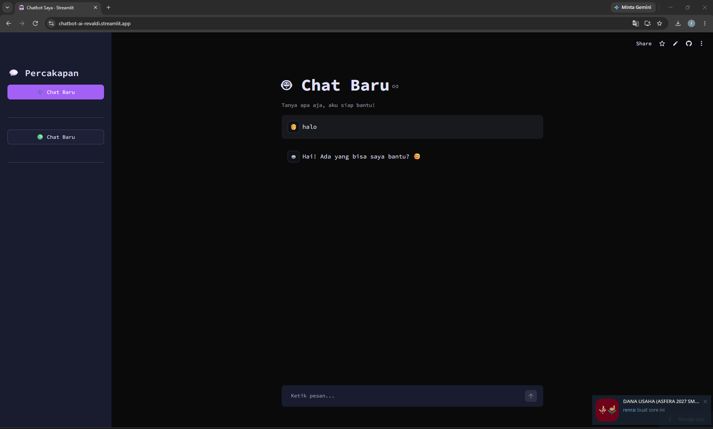

# 🤖 Chatbot AI Portofolio

Chatbot AI interaktif yang dibangun menggunakan Python, Streamlit, dan Groq API. Proyek ini dibuat sebagai portofolio untuk menunjukkan kemampuan dalam membangun aplikasi web berbasis AI.

## 🚀 Fitur Utama
- 💬 **Multi-Conversation:** Bisa membuat banyak sesi obrolan berbeda di sidebar (seperti ChatGPT).
- 💾 **Penyimpanan Lokal:** Riwayat obrolan otomatis tersimpan ke dalam file JSON.
- 🌙 **Custom Theme:** Tampilan dark mode dengan tema Cyberpunk.
- ⚡ **Streaming Response:** Jawaban AI muncul secara bertahap (efek mengetik).

## 🛠️ Teknologi yang Digunakan
- **Python** (Bahasa pemrograman utama)
- **Streamlit** (Framework untuk membuat UI web)
- **Groq API** (Mesin AI / LLM yang super cepat)
- **Llama 3 / GPT-OSS** (Model bahasa yang digunakan)

## 🔗 Live Demo
Kamu bisa mencoba aplikasinya secara langsung di sini:
**[Chatbot AI Revaldi](https://chatbot-ai-revaldi.streamlit.app)**
## 📸 Tampilan Aplikasi

---
*Dibuat dengan ❤️ menggunakan Python dan Streamlit.*
